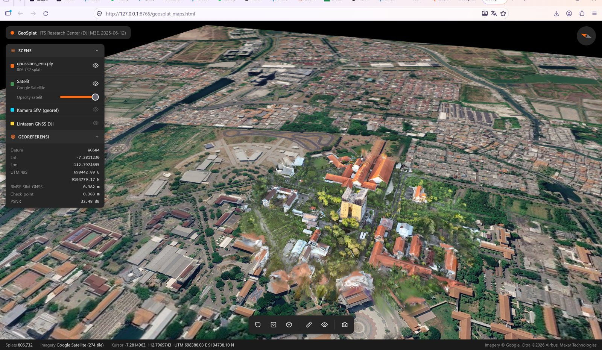
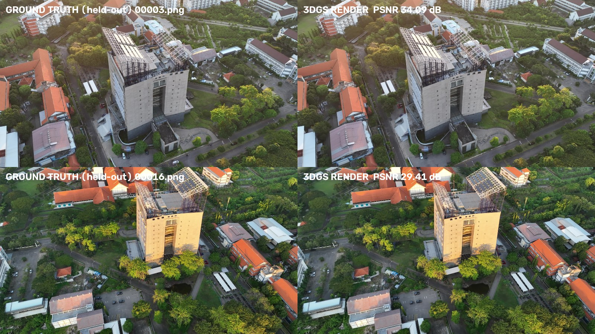
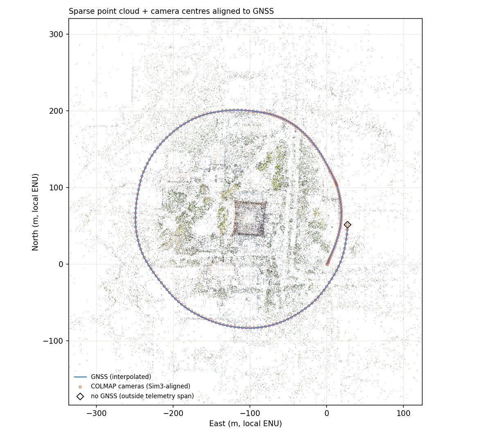

# GeoSplat

**DJI drone video → georeferenced 3D Gaussian Splatting, fully local, one click.**

Drag a DJI video (and its `.SRT`, if you have one) into the window and press **Mulai**. GeoSplat then:

1. decodes the flight telemetry, from the SRT and/or the GNSS track embedded in the MP4;
2. extracts frames and synchronises each one with the telemetry;
3. reconstructs the cameras with COLMAP Structure-from-Motion, using GNSS-guided image matching;
4. georeferences the model to WGS 84 / UTM with a robust similarity transform, and reports residuals and check points;
5. trains 3D Gaussian Splatting (official Graphdeco implementation) directly in metric ENU coordinates;
6. exports georeferenced Gaussians (ENU / UTM / original frame), a GS orthophoto with a world file, and the camera trajectory;
7. opens a **satellite viewer** in which the Gaussians stand on Google (or Esri) satellite imagery at their true position.

Nothing is uploaded. The video is read in place and never copied or modified.

> Methods, equations and the literature behind every step: **[docs/METHODS.md](docs/METHODS.md)**.


*Gaussian Splatting model (806 k splats) of the ITS Research Center, Surabaya, standing on Google satellite imagery
at its georeferenced position (DJI Mavic 3 Enterprise video, 107 s orbit).*

| Held-out view: photo (left) vs. 3DGS render (right) | SfM cameras aligned to GNSS (RMSE 0.38 m) |
|---|---|
|  |  |

Example run (RTX 4070 Laptop 8 GB): 216 frames → 216/216 registered, reprojection 0.92 px, SfM–GNSS RMSE 0.382 m
(5-fold check points 0.383 m), 1.07 M Gaussians, test-view PSNR 32.5 dB / SSIM 0.922 / LPIPS 0.130.

---

## Quick start (Windows)

1. Download and unzip GeoSplat anywhere (for example `D:\GeoSplat`).
2. Double-click **`GeoSplat.bat`**. The first run creates `.venv`, installs the Python packages, and fetches portable FFmpeg and COLMAP into `tools\` if they are not already installed.
3. In the app, click **Siapkan GPU…** once. This installs the GPU part: PyTorch CUDA and Graphdeco 3D Gaussian Splatting, cloned from the official repository and compiled locally.
4. Drag `DJI_xxxx.MP4` (+ `DJI_xxxx.SRT`) onto the window, or onto `GeoSplat.bat` itself, then press **Mulai**.
5. When it finishes, the satellite viewer opens automatically. Use **Buka Viewer Satelit** to open it again later.

Optional: paste a Google API key with the **Map Tiles API** enabled into the *Satelit* field to get Google satellite imagery. Without a key, Esri World Imagery is used. Restrict the key to the HTTP referrer `http://127.0.0.1:8765/*`.

Command line: `.venv\Scripts\python -m geosplat.cli VIDEO.MP4 [--srt FILE.SRT] [--fps 2] [--profile balanced] --serve`

### Requirements

| | needed for | installed by |
|---|---|---|
| Windows 10/11 x64, Python 3.10–3.13 | everything | user (`winget install Python.Python.3.12`) |
| FFmpeg | frames | `GeoSplat.bat` (portable download) or existing install |
| COLMAP (CUDA build) | SfM | `GeoSplat.bat` (portable download) or existing install |
| NVIDIA GPU ≥ 8 GB VRAM + driver | Gaussian Splatting | user |
| CUDA Toolkit 11.8 / 12.x, VS 2022 Build Tools (C++), git, conda or Python 3.10–3.12 | compiling the 3DGS CUDA extensions | user (the GPU setup prints the exact `winget` commands) |

Without the GPU part, stages 1–3 (telemetry, SfM, georeferencing) still run.

## Supported input
* **DJI per-frame SRT** (current `[latitude: …]` format and older `GPS(lon,lat,alt)` format). The SRT is detected automatically next to the video.
* **Embedded DJI `djmd` track**. The field mapping is verified for `dvtm_wm265e` (Mavic 3 Enterprise); other protos are used only if their positions are plausible. If a video has neither source, GeoSplat stops with a clear message.

## Output (`<video>_GeoSplat\`)
```
01_Metadata/  video_info.json, metadata_report.txt, djmd field inventory, hardware
02_Telemetry/ telemetry.csv (every frame), frame_telemetry.csv, plots, telemetry_analysis.html
03_Extracted_Frames/fps_2/  F<frame>_T<ms>.jpg + manifest
04_COLMAP/  05_Sparse_Reconstruction/  camera_poses.csv, sparse model, GNSS check
06_Georeferencing/  transform.json (all transforms + conventions), georeferenced_cameras.csv,
                    sparse_enu_txt/ (metric COLMAP model), PLYs (local/ENU/UTM), time-offset scan
07_Gaussian_Splatting/  dataset + Graphdeco model, renders, metrics
08_Exports/  gaussians_enu.ply, gaussians_utm_epsg327xx_offset.ply, gaussians_local_colmap.ply,
             gaussians_crs.json, camera_trajectory.csv/.geojson, gs_orthophoto_wgs84.png(+.pgw/.prj),
             web/ (satellite viewer)
09_Reports/  phase reports (txt/html), figures
```

## Accuracy statement
GeoSplat reports the **relative** agreement between SfM and the DJI GNSS track: residuals, a 5-fold check-point RMSE, and a time-offset scan. Without RTK or ground control points, the absolute position inherits the GNSS error (typically metre level). DJI's `abs_alt` has no documented vertical datum, so check heights against a known point before using them for measurement.

## Repository layout
```
GeoSplat.bat            one-click launcher (first run = setup)
geosplat/               library: geodesy, telemetry, sync, Sim3, georef, Gaussians, pipeline, GUI, CLI
scripts/stage1..5_*.py  pipeline stages (each runnable on its own)
setup/                  install.bat, bootstrap_tools.py, install_gaussian_splatting.py, GPU toolchain check
web/viewer.html         satellite Gaussian viewer (WebGL2)
docs/METHODS.md         methods + references
tests/                  unit tests (pytest)
.github/                CI (unit tests on Windows + Linux), issue / PR templates
```

## How to cite
If you use GeoSplat, please cite this repository (see `CITATION.cff`) **and the methods it builds on**. At minimum: Kerbl et al. 2023 (3D Gaussian Splatting), Schönberger & Frahm 2016 (COLMAP), and Umeyama 1991 (similarity estimation). The full list is in [docs/METHODS.md](docs/METHODS.md#references).

## Contributing
See [CONTRIBUTING.md](CONTRIBUTING.md). New methods must be documented with references.

## Licence
GeoSplat's own code is released under the MIT licence (`LICENSE`). GeoSplat **does not include** third-party code: Graphdeco 3D Gaussian Splatting, COLMAP and FFmpeg are fetched from their official sources at install time and remain under their own licences. **Note:** the Graphdeco Gaussian Splatting software is licensed for *non-commercial research and evaluation use only*. See `THIRD_PARTY_NOTICES.md`.

---

### Ringkasan (Bahasa Indonesia)
GeoSplat mengubah video drone DJI menjadi model 3D Gaussian Splatting yang tergeoreferensi. Semua proses berjalan secara lokal; video tidak diunggah ke mana pun.

**Cara pakai:**
1. Jalankan `GeoSplat.bat`.
2. Klik **Siapkan GPU…** (cukup sekali).
3. Seret file video (dan SRT, kalau ada) ke jendela aplikasi.
4. Klik **Mulai**.

Setelah selesai, viewer satelit terbuka otomatis. Penjelasan metode dan daftar sitasinya ada di `docs/METHODS.md`.
